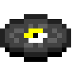

<h1 align="center">GlassPlayer</h1>

<b>An advanced music player built right into Minecraft.</b> 
Fabric &amp; NeoForge · Minecraft 26.3 &amp; 1.21.1 · EN / PL / DE / RU / ES

---

Bring your own music, sing along with lyrics floating in the world, and let songs flow into each other like a DJ set, all in a clean, vanilla-styled UI. Press **M** in game and play.

## Download

Get the latest version from the [**Releases**](https://github.com/Krixishere/glassplayer/releases/latest) page. Pick the file for your loader and Minecraft version:

| File | Loader | Minecraft |
|---|---|---|
| `glassplayer-<version>.jar` | Fabric (needs Fabric API) | 26.3 |
| `glassplayer-<version>+1.21.1.jar` | Fabric (needs Fabric API) | 1.21.1 |
| `glassplayer-<version>+26.3-neoforge.jar` | NeoForge | 26.3 |
| `glassplayer-<version>+1.21.1-neoforge.jar` | NeoForge | 1.21.1 |

Put the file in your `mods` folder. The mod works on the client alone; install it on the server too for server discs, jukeboxes and listening together.

## Features

**Your music, anywhere**
- Paste a YouTube, YouTube Music, SoundCloud or Spotify link (track, album or playlist), or a direct file link
- Drop your own MP3, OGG, WAV, FLAC or M4A files onto the window
- Covers and lyrics are fetched automatically (lyrics from [LRCLIB](https://lrclib.net))
- Duplicate detection, readable file names, an "E" label for explicit songs

**Lyrics in the world**
- 3D lyrics that float in front of you like a music video, highlighted word by word
- They follow the scene: cut to where you look, land on cave walls, lead the way when you walk, rise above fights
- 20 text animations, custom styles with a live preview, or plain on-screen subtitles
- Lyrics editor with tap-to-sync for lines and single words

**AutoMix**
- Songs are analysed (intro, outro, tempo) and blended with beat-aligned, DJ-style transitions and a filter sweep

**Player**
- A music-app layout: library sidebar (Songs, Favourites, Recently added, Recently played, Most played), a mini player at the bottom and a full-screen Now Playing view that slides up with lyrics and Up next
- Queue, shuffle, repeat, playlists and "play next", favourites with the heart, play counts
- Sleep timer (15 / 30 / 60 min) that fades the music out
- Mini player in the pause menu, customizable Now Playing bar, live FFT equalizer
- A "What's new" changelog in the options

**Server features** (mod on the server and on clients)
- OPs upload songs as custom music discs with their own look and hearing range
- Burn songs onto craftable blank discs; jukeboxes play them for everyone, fading with distance, with holograms
- Public and private playlists, and listening together in sync
- Vanilla clients can still join servers that run the mod

Links from YouTube, SoundCloud and Spotify need **yt-dlp** and **ffmpeg**. GlassPlayer can download both for you (Options → Tools).

## License

**All Rights Reserved** (see [LICENSE](LICENSE)). You may download the official releases and play with them. Copying, modifying, re-uploading or reusing any part of GlassPlayer requires the author's written permission. The source code is not public.

Versions 1.0.0 and 1.1.0 were released under GPL-3.0 and keep that license.

GlassPlayer bundles [JLayer](https://github.com/umjammer/jlayer) (LGPL) for MP3 decoding.

Minecraft is a trademark of Mojang AB. GlassPlayer is not an official Minecraft product and is not associated with Mojang or Microsoft.
